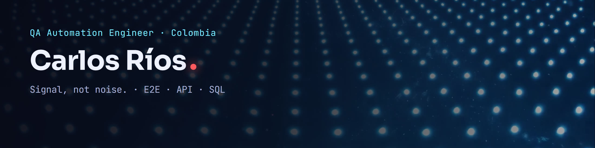

### I find the bug before your users do.

QA Automation Engineer and Systems Engineer from Colombia, with 2+ years automating E2E, regression and API tests for web applications. I build suites that only fail when something is really broken, so the green in your pipeline actually means something.

---

### What I test

| Layer | How |
|---|---|
| **UI / E2E** | Selenium WebDriver, Java, Serenity BDD and Cucumber. Page Object Model and explicit waits instead of fixed sleeps. |
| **API** | REST validation with Postman: HTTP methods, status codes and JSON contracts. |
| **Data** | SQL queries (JOIN, GROUP BY) to confirm that what the screen shows is what was actually saved. |
| **Pipeline** | Suites running in CI/CD with automatic feedback on every run. |

Defects go to Jira with steps, evidence and expected versus actual result, so a developer can reproduce them on the first try.

### Stack

**Strong**

**Learning now**

**Ways of working:** Agile, Scrum, Kanban, BDD · smoke, regression, integration and end to end testing · AI assistants for test design, with every result reviewed by hand.

### Right now

- Open to QA Automation opportunities.
- Improving my English from B1 toward B2.
- Adding Playwright and Cypress to my Selenium toolbox.

<b>Leer en español</b>

 

**Encuentro el error antes que tus usuarios.**

Soy QA Automation Engineer e Ingeniero de Sistemas en Colombia, con más de 2 años automatizando pruebas E2E, de regresión y de API en aplicaciones web. Construyo suites que fallan solo cuando algo está roto de verdad, para que el verde de tu pipeline signifique algo.

- **UI / E2E:** Selenium WebDriver, Java, Serenity BDD y Cucumber, con Page Object Model y esperas explícitas.
- **API:** validación de servicios REST con Postman: métodos HTTP, códigos de estado y contratos JSON.
- **Datos:** consultas SQL (JOIN, GROUP BY) para confirmar que lo que muestra la pantalla es lo que quedó guardado.
- **Pipeline:** suites corriendo en CI/CD con feedback automático en cada ejecución.

Estoy abierto a oportunidades como QA Automation. Mira mi [portafolio](https://carlosrios-dev.github.io) o descarga mi [CV en español](https://carlosrios-dev.github.io/assets/cv/Carlos-Rios-CV-ES.pdf).

